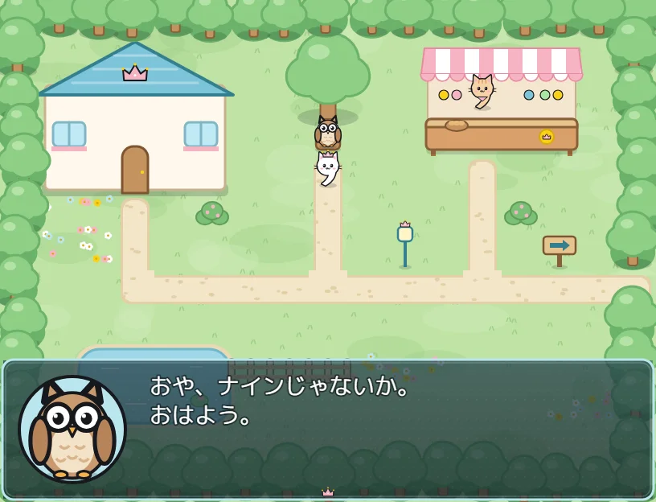
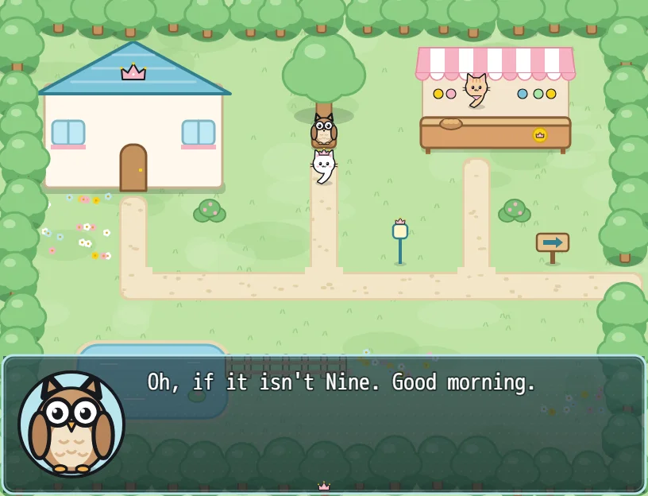

# Nine and the Forest of Words (ナインとことばの森)

A five-minute RPG Maker MV game in Japanese, starring Nine the crowned cat, for trying
[ninetranslator](https://ninetranslator.com) on. You download it, open its folder in the
translator, translate, install, and play. If you can read the ending, it worked.

<p>
  
  
</p>

## Play it

1. Download **`ninetranslator-tutorial-windows.zip`** from the
   [latest release](https://github.com/Game-Translator-Project/ninetranslator-tutorial-rpgm/releases/latest)
   and unzip it.
2. Open https://ninetranslator.com/translate/ in Chrome or Edge and click **Choose folder…**.
   Pick the unzipped folder (the one with `Game.exe` in it).
3. Pick your language and click **Translate**. Then click **Install into the game**.
4. Double-click `Game.exe`.

## Is the download safe?

Everything in the zip comes from this repository, and you can check that.

- **GitHub builds the zip from the source here.** It is built by the [Build workflow](.github/workflows/build.yml)
  from the release's tag. Nobody uploads it by hand. The build is attested, so this command
  proves the zip came from this repository:
  ```
  gh attestation verify ninetranslator-tutorial-windows.zip -R Game-Translator-Project/ninetranslator-tutorial-rpgm
  ```
- **`Game.exe` is NW.js, unchanged.** RPG Maker MV games run on [NW.js](https://nwjs.io), and so
  does this one. The build takes `nwjs-v0.29.4-win-x64.zip` from dl.nwjs.io, checks its SHA-256
  (`806cb45519af60b184ce3a4e0f573b4d64e43d9758e552787a965ac18b821b1b`, pinned in `build.ts`), and
  renames its `nw.exe` to `Game.exe`, the same way RPG Maker does. Its SHA-256 is
  `141dd6c7281ff31f31aa1ad01913d32dd4ae679b27031cccd95b88fdbea0cd0b`. On Windows you can check it
  with `certutil -hashfile Game.exe SHA256`.
- **The game itself is plain JavaScript and JSON** in `www/`. `www/js/rpg_*.js` are RPG Maker MV's
  [open-source core scripts](https://github.com/rpgtkoolmv/corescript). `www/data/*.json` is the
  story, written by `game.ts`, and `www/img/` holds the pictures in `assets/`.
- **You can rebuild it yourself.** The zip comes out the same byte for byte, so its SHA-256 matches
  the one in the release's `SHA256SUMS.txt` (see below).

## Build it yourself

You need [Node.js](https://nodejs.org) 20 or newer.

```
npm ci
npm test                             # the pictures exist, events are well formed, every line fits
npm run build                        # dist/ninetranslator-tutorial: www/ + package.json (plays in a browser)
npm run build -- --windows           # + Game.exe (NW.js v0.29.4, downloaded once into .cache/)
npm run build -- --windows --zip     # + dist/ninetranslator-tutorial-windows.zip, and its SHA-256
npm run art                          # redraws the pictures in assets/ (needs: npx playwright install chromium)
```

## What is where

| | |
|---|---|
| `game.ts` | The story and database in MV's JSON shapes: three maps of events, common events, a troop, actors, items, skills, and the Japanese menu terms. A tiny command language (`say`, `choices`, `loop`, `transfer`, `battle`, `shop`…) writes the event lists. |
| `layout.ts` | The three maps, 17 × 13 tiles each: the terrain and the furniture on it. The painter draws from it, and `passability()` turns it into where Nine can walk. |
| `art/paint.js`, `art/draw.ts` | Every picture, drawn on canvases in a headless browser and saved into `assets/`: Nine, Mike, the owl, the slime, the faces, the three maps, the title, the battle, the window skin and the icons. |
| `assets/` | The drawn pictures. Each map is one picture (a parallax) over an invisible tileset whose tiles only mean walkable, wall or counter. |
| `engine/` | RPG Maker MV's open-source core scripts ([rpgtkoolmv/corescript](https://github.com/rpgtkoolmv/corescript) community-1.3b, MIT; the commit is in `CORESCRIPT_COMMIT`), with their libraries, page template and the M+ 1m font. `NOTICES.txt` becomes the game's `THIRD-PARTY-NOTICES.txt`. |
| `build.ts` | Puts the game folder together, adds NW.js for Windows, and zips it. |
| `README-player.txt` | The `README.txt` players find in the zip. |
| `test/game.test.ts` | Checks that every picture named exists, events are well formed, every place can be reached and every line fits its window. |

No RPG Maker licence is needed. The engine is MIT, the pictures and text were made for this game,
and nothing from RPG Maker's runtime package (RTP) is used. The game has no sound.

## Notes for changing it

- **Don't put a name line above dialogue.** The face shows who speaks. Translators re-flow a
  message box's lines into one paragraph, so a first line holding only a name would end up glued
  to the sentence after it ("Professor Owl Oh, if it isn't Nine.").
- **Battle messages follow the user's name.** A skill's `message1` is `の攻撃！`, not `%1の攻撃！`
  (`%1` there is the skill's name).
- **Releases:** push a tag `v*` and the Build workflow publishes the release.

## Licence

The engine in `engine/` is MIT; see `engine/NOTICES.txt` for its authors and the libraries it
uses. NW.js is MIT (its own notices ship as `credits.html` in the zip). The game's story, pictures
and code are © ninetranslator. You are free to download, play, translate and share the game,
translated or not.
